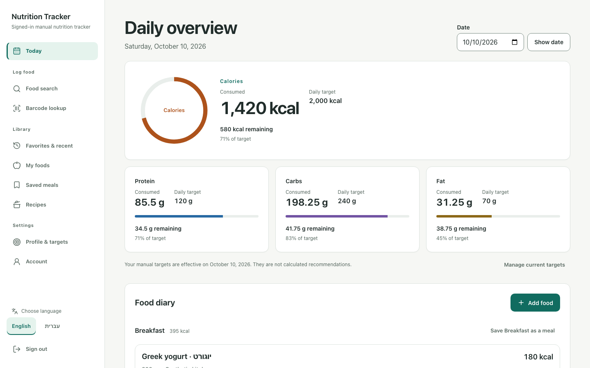
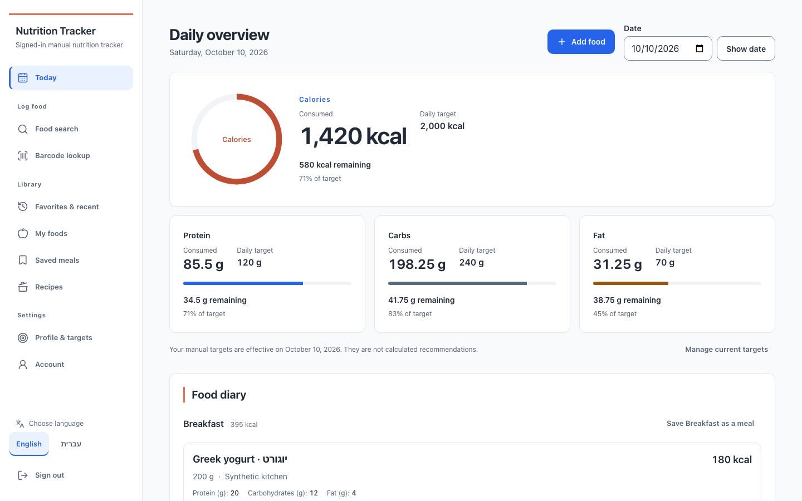

# Phase A rendered evidence

Actual integrated app, local synthetic fixtures, Chromium, scale 1, reduced
motion. Baseline `da15f5e` and implementation use the same fixture account and
snapshots. No design HTML or synthetic component harness is pictured.
Source and image SHA-256 values are in [manifest.json](manifest.json).

| Today initial viewport | Before | After |
| --- | --- | --- |
| 1440px EN | [Before](before-1440-en-populated.png) | [After](after-1440-en-populated.png) |
| 390px EN | [Before](before-390-en-populated.png) | [After](after-390-en-populated.png) |
| 390px HE | [Before](before-390-he-populated.png) | [After](after-390-he-populated.png) |
| 320px HE | [Before](before-320-he-populated.png) | [After](after-320-he-populated.png) |

Desktop comparison:

Additional inspected states:

- [Missing manual targets](after-390-en-missing.png).
- [Optional setup invitation](after-optional-setup.png); its placement after the
  mounted manual form is asserted by Playwright.
- [Rejected entry and keyboard focus, EN](after-validation-focus-en.png),
  [HE](after-validation-focus-he.png).
- [Pending disabled button](after-pending-en.png).
- [Forced colors, HE](after-390-he-populated-forced-colors.png).
- [Authentication](after-auth-en.png), [Setup](after-shared-en-setup.png),
  [Search](after-shared-en-search.png), [My Foods](after-shared-en-my-foods.png),
  [Saved Meals](after-shared-en-saved-meals.png), [Recipes](after-shared-en-recipes.png),
  [Account](after-shared-en-account.png).
- [Shared EN/HE axe findings](shared-audits.json): zero violations; incomplete
  results are retained separately from violations.
- [Resolved palette and contrast](color-validation.json).

Automated viewport checks also cover 768 and 1024px (and 1280px), both locales,
native/no-JS navigation and submission, keyboard and forced colors. The full
local evidence package includes additional full-page, Hebrew shared-screen,
empty and exceeded-target captures. This repository retains the selected set
above so the PR stays bounded. Native popups, physical devices and manual
screen-reader use are not qualified by these screenshots. The large calorie
summary and existing diary-row architecture intentionally await Phase B.
