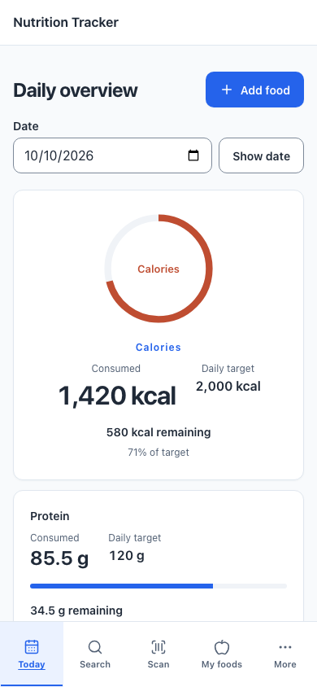
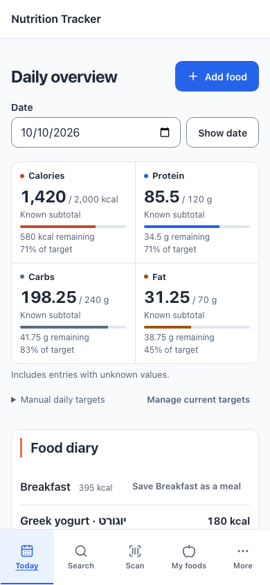

# Phase B integrated visual evidence

All images show the real integrated application with local synthetic data, Chromium, device scale 1 and reduced motion. No standalone design HTML substitutes for the application. Each manifest records viewport, locale, fixture date/state, source commit/tree, source hashes, screenshot hashes and document overflow. The final capture engine is Chromium 149.0.7827.55; the baseline retained the engine name and used the same installed browser runtime.

- Before application: `abe0124c485a9a298d9a7fbf7ace76b00771fecc`, tree`681fb887c9463eb220c16ed02dfd3510280cebe8`.
- After application: `9012331c990faa52f0f8b726d72027dba70f25fe`, tree`648e7cd385ae6db94ea4103f6e6196ba0fbaab97`.
- The same synthetic account and stored fixture snapshots were used for paired captures. Runtime-only local Supabase IDs/ports and capture-config paths differ from tracked configuration. All eight rendered application source hashes match the implementation commit. Later evidence/test-measurement documentation commits do not change the rendered application.

## Matched geometry

Positions are document CSS pixels at scroll top. Summary height measures the metric band, excluding its shared unknown note and target explanation/navigation. Diary height measures the full meal workspace. These measurements do not establish task-speed improvement.

| Locale/state/viewport | Summary before → after | Diary heading y before → after | First food y before → after | Diary height before → after | Fully visible rows before → after |
| --- | --- | --- | --- | --- | --- |
| en / populated / 1440×900 | 468.6 → 136.7 | 694.6 → 380.2 | 794.6 → 476.2 | 1428.0 → 946.8 | 0 → 3 |
| en / populated / 390×844 | 1000.5 → 292.4 | 1370.5 → 631.9 | 1502.5 → 727.9 | 1626.4 → 1187.5 | 0 → 0 |
| he / populated / 390×844 | 1000.5 → 274.4 | 1370.5 → 613.9 | 1502.5 → 737.9 | 1666.4 → 1292.3 | 0 → 0 |
| he / forty / 320×720 | 1056.1 → 273.2 | 1426.1 → 635.2 | 1558.1 → 759.2 | 10309.6 → 8062.0 | 0 → 0 |
| en / empty / 390×844 | 1000.5 → 252.4 | 1370.5 → 566.4 | — → — | 348.1 → 286.4 | 0 → 0 |

At 390px, the populated summary band is 70.8% shorter in English and 72.6% shorter in Hebrew; the first food starts about 775px / 765px earlier. At 1440px, three full entries now fit in the first viewport. At 390px, the first row begins above navigation but does not fit fully; at 320px the long-name stress row begins below the first viewport. The full-page stress image and focused row crop preserve review of every identity and all 40 entries. No horizontal overflow was detected.

The implementation remains taller than the standalone 001B specimen (about 218px band / 554px first food at 390px): it retains the accepted application shell/header, full localized remaining/percentage wording, explicit per-nutrient unknown cues, and visible Edit/Delete controls. Native target details expose the complete date/recommendation explanation on demand. Geometry is not physical-device or manual assistive-technology acceptance.

## Representative comparison

| Phase A, EN390 | Phase B, EN390 |
| --- | --- |
|  |  |

[Desktop after](after-1440-en-populated.png) · [Hebrew mobile](after-390-he-populated.png) · [Full mobile diary](after-390-en-populated-full.png) · [Long Hebrew row at 320px](after-320-he-long-row.png) · [All 40 entries](after-320-he-forty-full.png)

## State coverage

The after captures include six representative entries, configured targets, no targets, empty diary, partial targets, explicit zero targets, over-target values, mixed known/unknown snapshots, forty long-name entries, Hebrew RTL and forced colors. All-null targets and retrieval failures are covered by authenticated browser regressions; retry/error behavior is not inferred from a screenshot. The native target details diagnostic covers both locales without JavaScript at 390×480, keyboard Enter/Space, retained manual draft/request identity and bottom-navigation clearance.

## Exact evidence inventory

- `after-1440-en-populated.png`
- `after-320-he-forty-full.png`
- `after-320-he-forty.png`
- `after-320-he-long-row.png`
- `after-390-en-empty.png`
- `after-390-en-exceeded.png`
- `after-390-en-missing.png`
- `after-390-en-partial.png`
- `after-390-en-populated-full.png`
- `after-390-en-populated.png`
- `after-390-en-subtotalMixed.png`
- `after-390-en-zero.png`
- `after-390-he-populated-forced-colors.png`
- `after-390-he-populated.png`
- `after-manifest.json`
- `before-1440-en-populated.png`
- `before-320-he-forty.png`
- `before-390-en-empty.png`
- `before-390-en-populated.png`
- `before-390-he-populated.png`
- `before-manifest.json`
- `layout-comparison.json`
- `local-validation.json`
- `native-target-details.json`
- `README.md`
