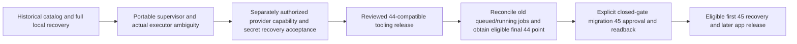

# NUTRITION-DIARY-CORRECTNESS-002C1 — Engineering report

## A. Executive verdict

**NUTRITION_DIARY_CORRECTNESS_002C1_BLOCKED_WITH_EXPLICIT_FINDINGS**

This is the coherent first implementation boundary allowed by task section 18:
versioned local live role/catalog equivalence, native schema restoration on actual
44/45 application schemas, fresh CLOSED operational reconstruction and exact-head
security qualification. It does not qualify the complete recovery pipeline.

The remaining critical prerequisite is a historical snapshot-compatible catalog
model. This local comparator deliberately cannot certify 002C's historical raw
catalog or promote recovery eligibility. Complete encrypted shared-snapshot data,
real Auth service/lifecycle, full application gate behavior, portable supervision,
provider/key recovery and full-service timing also remain unqualified.

## B. Verified source baseline

Fresh GitHub reads and local object/hash checks agreed before changes:

| Item | Exact identity / state |
|---|---|
| main | `50716d3759e9b75c66fe98b9c483ebb10c28b531` |
| PR #200 | `f969a52e297a3de5453e2bee1904eec552d43c63`; Open, Draft, unmerged |
| PR #201 | `7201879935903e846dab5e2adef6d86beea0d597`; Open, Draft, unmerged |
| PR #201 tree | `24211f8719018cba2743bf6b90d0451ca0bffaef` |
| PR #201 base | `codex/nutrition-002a-recovery`, exact `f969a52…` |
| Historical 44 capsule | `2617a6012d743e3196c7c2618e4ea46cbfe5c600` |
| Historical 44 tree | `04e719ff60e0472a0760236c7fe6a481c54b7d17` |
| Migration 45 SQL SHA256 | `d77cb58ae09a057892842fdc7fe0f6694be1948aafaf67ff2ee2d0f5d976dfbc` |
| New branch | `codex/nutrition-002c1-fidelity`, based exactly on PR #201 |

A new managed worktree was created. Predecessor branches, main and migration bytes
were preserved. The 002A/002B/002C source, reports, runbooks and retained evidence
were reviewed as historical input; their passing results are not attributed to
this implementation. This task read public documentation only, never hosted
Supabase project state. Installed dependencies are reused through an ignored
symlink; the lockfile is unchanged and no dependency was upgraded.

## C. Recovery semantics

The relational point remains one PostgreSQL snapshot of application rows, four
selected durable Auth tables, exact migration identities and compatible catalog
observations. Operational authority/history is separate. External provider
configuration, secrets, key custody and binary compatibility are separate again.
No claim makes all three categories universally atomic.

This PR compares live schema/security under isolated local administrative custody.
It proves neither a relational recovery point nor provider recoverability.
`recoveryEligible`, `historicalSnapshotCertified` and `producerAuthenticated`
remain false. The 24-hour RPO and eight-hour RTO remain unachieved objectives.

## D. Implemented architecture

The versioned contract is `nutrition-002c1-logical-catalog/v1`, PostgreSQL 170006,
mode `ISOLATED_LOCAL_LIVE_ONLY`. `catalog.sql` is repository-checksummed. A fixed
transport creates two independent digest-pinned, no-network/no-port, tmpfs-only
clusters. It rejects pre-existing names, uses immutable returned container IDs for
execution/cleanup, and verifies identity and native server/dump versions.

`observeLocalCatalog` obtains one local live model. `compareCatalogs` compares full
record multisets, including duplicates, unexpected grants and dependency edges.
It reports mismatch categories without leaking values. The expected model must
come from independently trusted source/replay; equality is not producer approval.

The separate local overlay adapter composes unchanged checksum-verified v1 SQL
and exact 61-table gate installation before one COMMIT. It never copies a source
lease/OPEN state, sets IDLE, or imports owner PIDs. No ordinary backup, restore,
scheduled job or Production validator imports the new modules.

## E. Changed files

| File | Purpose |
|---|---|
| `scripts/nutrition-002c1/local.mjs` | Fixed isolated transport, container identity, bounded native tools and SQL checksum |
| `scripts/nutrition-002c1/catalog.sql` | Typed logical catalog, security and dependency observations; unsupported-kind refusal |
| `scripts/nutrition-002c1/catalog.mjs` | Strict version/mode/model checks, multiset comparator, source digest and safe diagnostics |
| `scripts/nutrition-002c1/boolean-sql.mjs` | Conservative parenthesized AND/OR association rule |
| `scripts/nutrition-002c1/overlay.mjs` | Fresh atomic CLOSED local overlay/gates and unused-fixture rollback |
| `scripts/nutrition-002c1/qualify-local.mjs` | Actual migration replay, native schema restoration and negative qualification |
| `scripts/nutrition-002c1/contracts.test.mjs` | Trust/mode/precision/unknown-field/eligibility refusal tests |
| `scripts/nutrition-002c1/normalization.test.mjs` | Boolean preservation and actual SARIF-gate regression tests |
| `scripts/nutrition-002c1/check-sarif.mjs` | Require successful CodeQL execution and zero findings; bind sanitized exact-head result |
| `ops/recovery/nutrition-002c1/catalog-v1.json` | Version, scope, checksum and explicit normalization/unsupported policy |
| `ops/recovery/nutrition-002c1/README.md` | Detailed contract, bootstrap ACL rule, restore ordering, privilege and reproduction limits |
| `.github/workflows/nutrition-002c1-local.yml` | Exact-head stacked-only local qualification and pinned CodeQL; contents-read only |
| `scripts/check-workflow-security.mjs` | Whole-file immutable approval of the dedicated workflow |
| `scripts/check-workflow-security.test.mjs` | Inventory plus trigger/ref/permission/upload/pin mutation negatives |
| `docs/nutrition-diary-correctness-002c1-design.md` | Design/file plan recorded before code; this report records the bounded extensions |
| `docs/nutrition-diary-correctness-002c1-report.md` | A–P report |
| `docs/evidence/nutrition-diary-correctness-002c1/*` | Sanitized qualification, validation, development history, matrix and source/evidence index |

The overlay adapter, conservative boolean normalizer and SARIF gate were added to
the initial file plan as actual restoration/security tests established their need.
No application business logic, UI, migration, package, previous capture module or
Production workflow changed.

## F. Role/catalog fidelity

Logical addresses replace only identified OID fields. OID-dependent generated
internal FK trigger names use their constraint identity/event bits; the trigger
properties remain compared. Role names/attributes, membership grantors/options,
settings, schema ownership, table/column/function/type/default ACLs, function
signatures/definitions/owner/security/search paths, RLS/policies, constraints and
validation, indexes, trigger modes, views/rules, types, extensions, operator
families/classes/members, relevant dependencies and global parameter privileges
are observed. Missing/extra and unsupported namespace objects fail closed.

ACL expansion distinguishes default NULL ACL from an explicitly empty ACL and
retains grantor and grant option. No provider-version compatibility delta is
permitted. Source and target use the same pinned image; this is not hosted-version
acceptance. Password hashes, external binaries/configuration and dynamic runtime
dependency closure are not certified. Unapproved schemas/casts/tablespaces and
unsupported catalog kinds cause refusal rather than disappearing.

Schema comparison excludes physical statistics/freeze/storage identifiers and
fast-default storage markers. Full effective-row equality is still required
before these can participate in complete recovery. Int64 sequence definition
values are strings; unsafe JSON integers are rejected. Only the pinned volatile
Auth refresh-token sequence's schema is classified; no sequence values are backed
up and the existing capture sequence refusal is unchanged.

Real native restoration exposed nested boolean association changes. The narrow
normalizer preserves operand order, duplicates, literals, NOT and mixed precedence.
Tests reject quote/structure changes and unsupported grammar. Native dumps also
omit the initialized public schema PUBLIC USAGE baseline. The test first requires
rejection, then reconstructs that one fixed grant as `pg_database_owner` and
requires complete equality. The comparator never repairs arbitrary differences.

The concurrent replacement experiment checks actual pg_dump output, the old raw
function tuple and the live function-definition helper independently. It does not
treat a deparser as a historical observer. Historical raw-to-logical mapping and
change-and-revert/noncooperating DDL safety remain BLOCKED.

## G. Overlay and gate

Both actual schemas exercise new installation, 61-table coverage, unchanged
application ownership/ACL/RLS, repeated-install refusal, controlled unused cleanup
and atomic rollback after a failed local DDL transaction. The 45 path exercises
missing/extra objects, modified function/owner/EXECUTE, modified/missing/extra
triggers, OPEN gate, IDLE authority, unexpected epoch and unsupported version.

Fresh operational state is CLOSED/epoch-zero/RECONCILIATION_REQUIRED, no expected
source, no attempts or participants. Historical operational rows are never loaded.
The checksum and object behavior remain those of the unchanged 002C overlay v1;
there is no supported upgrade or in-place replacement path.

Installation needs the local bootstrap administrator to create its NOLOGIN owner,
schema and table triggers; application migrations run as `postgres`. This proves
no hosted permission capability. The helper owner has no direct application grants
or granted memberships, NOINHERIT/NOSUPERUSER/NOBYPASSRLS and an empty search path.
PUBLIC privileges still apply to a NOLOGIN role. Client operational USAGE/EXECUTE
is not granted. Privileged/table-owner trigger bypass is outside this gate.

Coverage/schema tests are not complete authenticated mutation, RPC, receipt,
COPY/TRUNCATE/cascade/MERGE/replica, stale transaction, drain or open-gate behavior
qualification. Those 002C component results remain HISTORICAL only.

## H. Actual 44/45 application qualification

All 44 historical SQL blobs are checked against the fixed capsule and repository
SHA256 inventory, then executed unmodified in both independent clusters. Migration
45 is executed unmodified afterward. There are no synthetic ledger markers and no
claim of a CLI-applied migration ledger. The schema has the independently checked
61 application/ingestion tables. Native schema dumps restore into the second
cluster and compare full supported schema/security models.

This is **schema qualification only**. It creates no synthetic owner/application
journey fixture. Complete application/Auth rows, receipts/idempotency, activation
and closure acceptance and effective target/snapshot history are NOT RUN here.
All 35 nutrients, SQL NULL/JSON null, explicit zero, four-decimal values, Saved
Meal/Recipe reuse, historical immutability and **Per Serving, Per 100 g and Per
100 ml** round-trip behavior remain BLOCKED for the new hybrid recovery path.

## I. Auth/security acceptance

The image's provider bootstrap schema is real pinned initialization, not a running
GoTrue acceptance test. No Auth account was fabricated or created. Sign-in,
refresh, invitation activation, reset/recovery, closure, restored authentication,
MFA/passkeys and durable-versus-volatile service behavior are NOT RUN.

Catalog negatives include provider function drift, broader anonymous grants,
column grant options, changed definer identity/mode/search path, missing access
guard, weakened RLS, validation/default privilege/membership/settings drift,
unapproved functions/objects and changed extensions. They establish fail-closed
comparison within the declared scope. Independent security/contract acceptance
and provider/key dependencies remain outstanding.

## J. Encrypted recovery

No new backup archive or private key is generated under this bounded scope.
Existing CMS AuthEnvelopedData/AES-256-GCM contracts and approved recipient are
unchanged. Complete encrypted shared-snapshot 44/45 recovery, restricted capture
evidence, full data equality and provenance/publication reconciliation are BLOCKED.
Earlier encrypted results remain HISTORICAL, not new integration evidence.

Live comparison, restricted encrypted evidence, public metadata, offline integrity,
isolated full restoration, producer provenance and final eligibility remain
separate layers. Neither a digest nor successful decryption proves producer trust
or recreates a snapshot. Detailed catalog values and SQL remain in bounded process
memory; no owner/Auth rows, snapshot token, PID, private key or content fingerprint
is placed in public qualification evidence.

## K. Process coordination

The new fixture transport binds an immutable container ID and confirms owned
container absence at cleanup. It refuses pre-existing/replaced resources. A live
exporter is used only for the historical-definition experiment; its token stays in
memory and its session is closed explicitly.

002C's durable admission/supervision implementation is unchanged and its evidence
is HISTORICAL. Portable process-start/PID identity, daemon delayed spawn, lost
registration/cleanup/seal/publication acknowledgement, concurrent reconciliation,
backend restart and complete fault qualification remain BLOCKED. This task ships
no hosted migration executor and authorizes no automatic migration retry.

## L. Validation

Use Node 22, local Docker and the pinned PostgreSQL/native dump 17.6 image:
`public.ecr.aws/supabase/postgres@sha256:28f0e16a019e648089fc1a6d333549a55548f6019c15ae4bd7cd58b989027518`.
No CLI behavior was changed; Supabase CLI remains locked to 2.116.0 and is not
required by this bounded native schema harness.

```sh
node --test scripts/nutrition-002c1/contracts.test.mjs scripts/nutrition-002c1/normalization.test.mjs scripts/nutrition-002c/contracts.test.mjs scripts/check-workflow-security.test.mjs scripts/phase-11i-recovery-contract.test.mjs scripts/phase-11i-populated-recovery.test.mjs scripts/phase-11i-public-verification.test.mjs scripts/phase-11i-psql-diagnostics.test.mjs scripts/phase-11i-cli-transport.test.mjs scripts/nutrition-002a-recovery.test.mjs
node scripts/check-workflow-security.mjs
node scripts/nutrition-002c1/qualify-local.mjs /absolute/new/sanitized-report.json
```

Focused ESLint and `git diff --check` also apply. The evidence index binds exact
implementation files, source commit, commands, classifications, runtime, retained
nonpassing development history and cleanup. See the qualification/matrix JSON for
executed results. A PASS in a declared subcase never reclassifies a critical
BLOCKED category. Exact delivery head and CI are recorded in the PR description
and its exact-head artifacts to avoid self-referential commit hashes.

## M. PR and CI

Delivery is a new stacked Draft targeting `codex/nutrition-002c-hybrid` at exact
`7201879935903e846dab5e2adef6d86beea0d597`. It must remain Draft and unmerged.
The complete final PR description records verified URL/head/tree/diff/checks and
artifact identities. PRs #200 and #201 must remain unchanged.

The dedicated workflow has only this stacked-base pull_request trigger, exact PR
head checkout, read-only contents, no dispatch/schedule/provider credential, pinned
actions/CodeQL, bounded jobs and sanitized 14-day artifacts. CodeQL analyzes both
JavaScript/TypeScript and Actions with `upload: never` and database upload disabled;
SARIF is retained as a CI artifact instead of mutating code-scanning configuration.
The result gate requires actual successful analysis and zero findings. PostgreSQL
SQL/privilege semantics still require manual review and executed database tests.
No predecessor CodeQL result is attributed to this head.

## N. Remaining blockers and rollout dependency

- Engineering: historical raw-to-logical catalog mapping and noncooperating DDL
  policy; complete supported dependency closure; full data/overlay encrypted restore;
  actual gate behavior and portable process/publication reconciliation.
- Security: independent review of normalization, overlay privileges, schema/data
  composition, trusted expected state and producer provenance. Local bootstrap
  authority is not proof of available narrowly scoped hosted roles.
- Provider/recovery: real GoTrue lifecycle and version compatibility; recoverable
  Auth encryption/signing/configuration, Vault capability rotation/reprovisioning,
  recipient custody, provider access, deployment/domain dependencies; timed
  full-service RPO/RTO and restore acceptance.
- Release: separately qualify a minimal 44-compatible tooling release before strict
  45 cutover. Keep the current scheduled backup contract until an accepted immutable
  44 tooling source replaces it. A fixed final-44 adapter must be distinct from a
  strict-45 entry point; no generic boundary override or artifact-selected checkout.
- Authorization: no merge, hosted preflight/overlay/backup/migration, secret change,
  workflow activation or deployment is granted here.

Dependency order:



A failed/aged capture leaves its point ineligible and the unresolved attempt
latched. A 44 compatibility release failure retains the prior scheduled route;
without an eligible final-44 point, cutover stops. Old nonparticipating jobs must
be stopped and independently reconciled; a new admission lock cannot fence them.
An ambiguous migration stays blocked pending authoritative exact-boundary readback,
never automatic retry. Future Product Owner approvals cover provider semantics,
privileges/overlay installation, compatibility release, final44/cutover and first45
acceptance. Daily scheduling alone cannot guarantee a rolling 24-hour RPO after a
failure; freshness/catch-up and eight-hour usable-service timing still need proof.

## O. Production safety

No hosted Supabase/project metadata, Auth/owner record, Production backup/private
key, Vercel/deployment/domain/environment/secret or infrastructure mutation occurred.
No migration bytes, main, Production workflow or capture refusal changed. No merge,
retarget, predecessor force-push/deletion, historical correction or Phase C work
occurred. Only this task's local fixtures, feature branch/Draft and CI artifacts
are within the authorized mutation scope. Existing stacks remain untouched.

## P. Next recommended task

**002C1A — Snapshot-native logical catalog qualification.** Implement the smallest
historical raw-to-logical mapping for the currently supported 17.6 scope, bind its
OID resolution/dependency evidence to the shared snapshot, and test it against
actual native dumps under concurrent catalog changes including change-and-revert.
Retain explicit refusal for unprovable operations and all existing Production
blockers. Do not begin full encrypted integration until that prerequisite passes.
