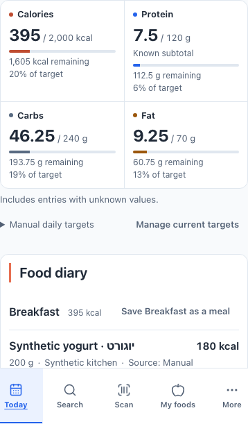
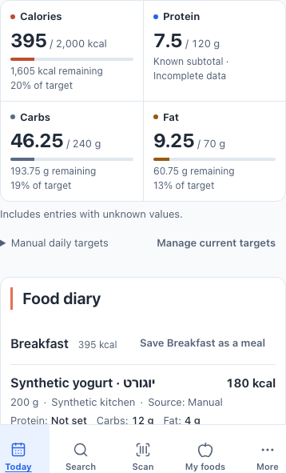
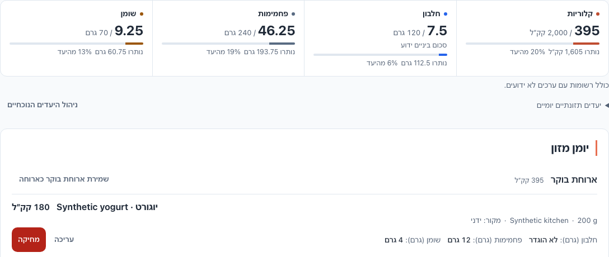
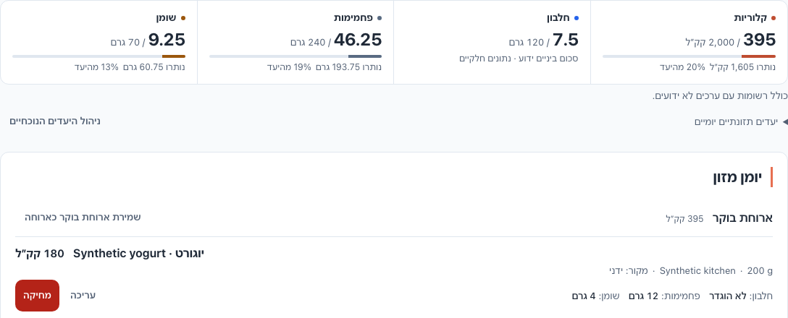

# NUTRITION-UX-REDESIGN-003R1 — independent-review corrections

Nutrients with incomplete stored snapshots now omit exact target comparisons, addressing UX-003-R01. The compact Phase B layout and existing logging architecture remain. This supplements the original Phase B acceptance record for Draft PR #189; final delivery HEAD/tree and exact-head CI conclusions are recorded in the PR delivery report. Keep the PR Draft for independent review. No merge or deployment is authorized.

## Baseline and bounded change

Reviewed head: `da97a64bb7f3303517b7eb0a1646b42f3aa01114`, tree `e96456cac98e4429c6af91fdeb373a2e7d8309fe`. Fresh preflight found the original checkout and attached task worktree clean, PR #189 open/Draft at that exact head, and remote main unchanged at `abe0124c485a9a298d9a7fbf7ace76b00771fecc`. Work continues on `codex/nutrition-ux-redesign-003-summary-diary`.

Implementation commit: `933cc37b9d3231ee2aacc81226c8535d03d843fb`, tree `311f000b01c4056eca7aec183a975e3cca14ece8`. Its exact six-file scope:

- `components/diary/nutrition-daily-summary.tsx`
- `components/diary/diary-entry-list-item.tsx`
- `messages/en.json`
- `messages/he.json`
- `tests/nutrition-daily-summary.spec.tsx`
- `e2e/ui-today-dashboard.spec.ts`

Additional changes are this report and the exact evidence inventory below. No reducer, arithmetic, snapshot, effective-target resolver, persistence, mutation, form-state owner, CSS, dependency, workflow or provider configuration changes.

## Corrected behavior

For each nutrient independently, one or more null snapshots make the summary comparison absent. Known subtotal, unit and any configured target remain. The existing “Known subtotal” label now explicitly adds “Incomplete data” / “נתונים חלקיים”. Remaining, over-target, completion percentage and progress bar are omitted for that nutrient, including positive and zero targets. Complete peer nutrients retain accepted target comparisons. Explicit stored zero remains complete; zero denominators never create a percentage or bar. Missing/unavailable targets and read-error/retry behavior remain distinct.

Compact diary rows use existing unitless nutrient names from `Diary.totals`; known values retain the localized gram unit once. Editor field labels keep their units. All names, values, sources, servings, explicit actions and accessible definition-list semantics remain.

`calculateDiaryTotals`, `countUnknownDiaryNutrients`, `compareNutritionTarget` and `roundDiaryValue` are unchanged. The standard React JSX pragma in the summary and component test enables real React server rendering under Playwright's test compiler without a new dependency or configuration change.

## Focused validation

All corrected checks passed: lint, typecheck, production build, **387 unit tests** (including **16 new EN/HE component cases**), and **52 focused browser tests with one intentional opt-in capture skip**. Actual execution commands and diagnostic paths are preserved in [local-validation.json](evidence/nutrition-ux-redesign-003r1/local-validation.json).

```sh
git diff --check
npm run lint
npm run typecheck
npm run test:date -- tests/nutrition-daily-summary.spec.tsx
npm run test:date
node /private/tmp/nutrition-ux-003r1-build.mjs
PLAYWRIGHT_PORT=3111 PLAYWRIGHT_HTML_OUTPUT_DIR=/private/tmp/nutrition-ux-003r1-focused-report PLAYWRIGHT_JSON_OUTPUT_FILE=/private/tmp/nutrition-ux-003r1-focused-results.json npm run test:e2e -- e2e/ui-today-dashboard.spec.ts e2e/retrieval-reliability.spec.ts e2e/date-correctness.spec.ts e2e/diary-mutation-correctness.spec.ts e2e/diary-nojs-completion.spec.ts --reporter=line,html,json
PLAYWRIGHT_PORT=3111 PLAYWRIGHT_HTML_OUTPUT_DIR=/private/tmp/nutrition-ux-003r1-retrieval-report PLAYWRIGHT_JSON_OUTPUT_FILE=/private/tmp/nutrition-ux-003r1-retrieval-results.json npm run test:e2e -- e2e/retrieval-and-core-loop.spec.ts --reporter=line,html,json
```

The first browser command's `retrieval-reliability.spec.ts` filter does not exist and was ignored; its four matched suites passed **47 tests / one capture-only skip** in 56.0s. The actual discovered retrieval suite was then executed separately and passed **5 tests** in 5.9s. Retrieval coverage is based on that follow-up, not the unmatched filter. The build wrapper invokes the existing `npm run build` with guarded loopback-only Supabase configuration. Both reviewed-head and corrected builds passed.

Two new browser regressions were also executed independently against the unchanged reviewed-head application. They failed as expected on (1) an incomplete metric still rendering comparison/track elements and (2) `Protein (g):` where the corrected row expects `Protein:`. Those are deliberate baseline defect reproductions. Both tests then pass in the corrected batch.

The first pushed head, `a2348d7a99fc138ae184ddaba90848f8484112cb`, received CodeQL alert [#6](https://github.com/Papi299/nutrition-tracker-app/security/code-scanning/6), high-severity `js/incomplete-multi-character-sanitization`, for the new component test's generic HTML-to-text replacement. That helper was removed. Tests now assert comparison text directly in rendered markup and validate exact definition markup with anchored matches; no general HTML filtering or entity decoding remains. All sixteen component cases, all 387 units, lint, typecheck and whitespace checks pass after this test-only correction. No alert suppression or dismissal was used. Rendered application bytes, browser tests and paired screenshots are unchanged. Fresh exact-head CodeQL must confirm the resolution; final gate results are recorded in the delivery report.

The browser matrix covers twelve independently specified fixture states in both locales at **390px and 1440px**: fully known; protein-only null; all-null; mixed known/null; known explicit zero; positive, missing, partial and zero targets; and complete over-target totals. It explicitly checks that incomplete protein does not suppress valid calorie, carbohydrate or fat progress. Existing Today reflow, EN/HE keyboard/accessibility, no-JavaScript, date/history, mutation, draft/idempotency, retrieval and tenant-isolation tests also passed. No manual assistive-technology or physical-device acceptance is claimed. Authoritative full-suite and cross-engine conclusions belong to the final exact-head CI record.

## Paired integrated evidence

The same synthetic account and two stored breakfast snapshots are used before and after: **395 kcal / 7.5g known protein / 46.25g carbohydrates / 9.25g fat**, with one protein null and all other nutrient values known. Targets are **2000 / 120 / 240 / 70**. No fixture values or target records changed between captures.

Before: protein shows **112.5g remaining**, **6%**, and a bar despite incomplete data. After: protein keeps **7.5g / 120g**, the known-subtotal/incomplete cue, and no comparison or bar. Calories still show **1,605 kcal remaining / 20%**, with their bar. Complete carbohydrate and fat comparisons are unchanged. Hebrew desktop also shows one unit per known row nutrient value.

These are actual integrated application screenshots in Chromium **149.0.7827.55**, device scale 1, reduced motion: EN **390×844** and HE **1440×900**. Both evidence capture runs passed. Manifests contain geometry, metric text, track counts, image SHA-256 and seven rendered-source SHA-256 values. Every before hash was independently verified against the reviewed head and every after hash against the implementation commit. The runtime archive HEAD remains the reviewed commit; its copied application bytes are explicitly bound to the implementation commit. No horizontal overflow was measured.

| EN mobile before | EN mobile after |
| --- | --- |
|  |  |

| HE desktop before | HE desktop after |
| --- | --- |
|  |  |

The mobile crop includes the actual fixed bottom navigation and the beginning of the first row; it does not claim full initial-row visibility. The desktop crop shows the complete first-row unit cleanup. Existing scrolling/action-clearance behavior is exercised by the preserved browser tests.

Exact evidence inventory (eight PNGs and four JSON records):

- `before-en-390-viewport.png`
- `before-en-390-summary-row.png`
- `before-he-1440-viewport.png`
- `before-he-1440-summary-row.png`
- `after-en-390-viewport.png`
- `after-en-390-summary-row.png`
- `after-he-1440-viewport.png`
- `after-he-1440-summary-row.png`
- [before-manifest.json](evidence/nutrition-ux-redesign-003r1/before-manifest.json)
- [after-manifest.json](evidence/nutrition-ux-redesign-003r1/after-manifest.json)
- [local-validation.json](evidence/nutrition-ux-redesign-003r1/local-validation.json)
- [cleanup.json](evidence/nutrition-ux-redesign-003r1/cleanup.json)

## Operational and review state

All testing used the fresh disposable `nutrition-ux-003r1` local stack with effective Docker bindings verified as `127.0.0.1`, local service ports 55720–55729 and app port 3111. Existing migrations/seed replayed without repository changes. Cleanup proof records zero task containers, volumes or networks and no temporary proxy script/socket. Unrelated stacks were untouched; evidence, runtime sources and logs remain.

No merge, deployment, Production records operation, hosted Supabase/database/Auth operation, migration change, provider change, unrelated-project access, credential disclosure or later phase. Required Validate (GitHub Actions app 15368) and both CodeQL languages must be inspected on the final PR head. Their final URLs, conclusions and exact SHA/tree are recorded in the delivery report without changing application source afterward. Independent ChatGPT review remains required. Keep PR #189 Draft and unmerged.
